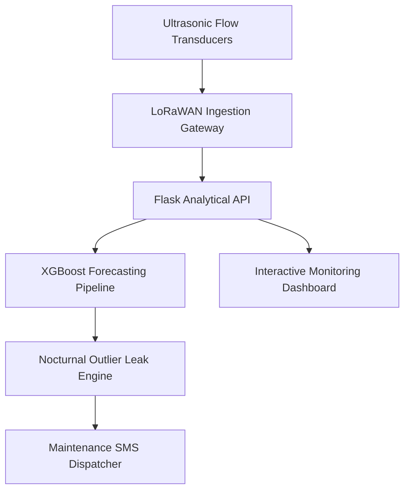

# 💧 Hydrolytics - AI-Powered Campus Water Demand Management System

[](https://github.com/Meera2926/Hydrolytics/actions)
[](https://python.org)
[](https://xgboost.readthedocs.io)
[](LICENSE)

An intelligent IoT-enabled campus water resource management platform that combines machine learning demand forecasting, acoustic and minimum night-flow leak detection, automated pump schedule optimization, and rainwater harvesting analytics.

---

## 🌟 Key Features

- **📈 XGBoost Demand Forecasting**: Hourly predictive modeling based on campus zone occupancy, weather temperature, and historical demand patterns.
- **🚨 Minimum Night-Flow Leak Detection**: Statistical baseline outlier detection identifying hidden pipeline fractures and fixture dripping during 01:00–04:00.
- **⚡ Time-of-Use Pump Scheduling**: Shifting pumping cycles to off-peak electrical tariff hours to slash energy operating costs.
- **🌧️ Rainwater & Greywater Recovery**: Rooftop run-off catchment calculators and greywater recycling yield models for landscape irrigation.
- **🧪 Potability & Quality Monitoring**: Multi-parameter WQI indexing evaluating pH, turbidity, and total dissolved solids (TDS).
- **📊 Real-time Dashboard**: Interactive Chart.js visual analytics monitoring storage tanks, flow rates, and carbon emissions.

---

## 🏛️ System Architecture



---

## 🚀 Quick Start

```bash
# 1. Clone repository
git clone https://github.com/Meera2926/Hydrolytics.git
cd Hydrolytics

# 2. Install dependencies
pip install -r requirements.txt

# 3. Run test suites
pytest

# 4. Start Flask server
python app.py
```

---

## 📚 Technical Documentation
- [Dataset Telemetry Schema](docs/DATASET_SCHEMA.md)
- [System Architecture](docs/SYSTEM_ARCHITECTURE.md)
- [REST API Specification](docs/API_DOCUMENTATION.md)
- [Leak Detection Formulation](docs/LEAK_DETECTION_ALGORITHM.md)
- [Pump Optimization Strategy](docs/PUMP_OPTIMIZATION_STRATEGY.md)
- [Hardware & LoRaWAN Deployment Guide](docs/CAMPUS_DEPLOYMENT_GUIDE.md)

---

## 📄 License
This project is open-source under the MIT License.
